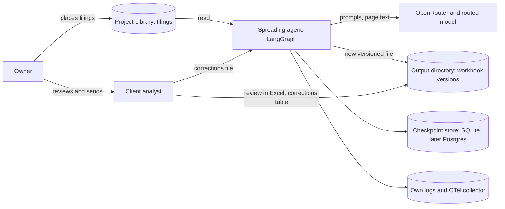

# Handover: financial statement spreading pilot (client-0001)

Status: v1.0.0, pilot scope. Owner reviews, merges and sends; nothing here has been sent to the client.

## What was built
An agent that reads one company's public filings from the project Library and writes an Excel workbook with the Income Statement, Balance Sheet and Cash Flow Statement in a standard line-item set. Each workbook has nine sheets: `Summary`, `IS`, `BS`, `CF`, `Source_Trace` (document, page, original line name and value for every number), `Reconciliations` (six pass/fail checks), `Open_Issues`, `Change_Log` and `Mapping` (where an analyst enters corrections). Totals in the statement sheets are live Excel formulas from a fixed whitelist. The agent never inserts a balancing figure and cannot send anything to anyone.

The six checks are code, not model opinion: the balance sheet balances, cash flow reconciles to the change in cash, retained earnings roll forward, net income on the P&L equals net income in the cash flow, subtotals match the source, and the detail lines add up to the printed totals. Tolerance is two units of the reported scale. A check that still fails after a capped repair loop becomes an exception with the exact difference.

Out of the pilot, as agreed: EBITDA normalisation, QoE-lite and KPIs (phase two).

## Pilot result (live run r15, 2026-10-24, five US 10-Q filings)
| Company | Result |
|---|---|
| A | delivered with one exception: cash flow vs balance sheet cash differs by 15, the restricted cash, which the filing prints only as a closing figure; the other five checks pass |
| B, C, D, E | all six checks pass |

Plug figures: 0 in all five. Every value in every workbook has a trace entry (126, 122, 150, 130 and 138 cells, all traced). All five workbooks passed the formula-error scan. The workbooks are in the project Library at `pilot/workbooks/r15/`.

Mapping accuracy (share of 190 sampled lines mapped to the right standard line): 96.3% (183 of 190), no company below 90%, scored in step 17. It has not been rescored since steps 25 to 30 changed the line set.

Cost and time per company (estimate from the run, not a quote): 31,000 to 96,000 tokens, 85 to 273 seconds, about USD 0.06 on average, USD 0.28 for all five (upper bound). Human review time was not measured.

Details of every step and each earlier run: the engagement plan, `docs/pilot-report.md`.

## Architecture
The full description is `docs/architecture.md` (as built); it is the only copy to maintain. Context diagram:

Stack: LangGraph (Graph API), OpenRouter as the model provider, Python 3.12, XlsxWriter and openpyxl for workbooks, SQLite checkpoints, OpenTelemetry for traces.

## Run and deploy
- Install: `pip install -r requirements.txt` (add `requirements-dev.txt` for tests).
- The host needs LibreOffice (`soffice`): `verify_workbook` recalculates every workbook and fails closed without it, so `finalize` is blocked rather than skipped.
- Run the pilot on filings in the Library: `PYTHONPATH=. python scripts/run_pilot.py --library <library root> --results <folder under the library> --price-in 0.30 --price-out 1.20 company-A=<path/under/library> ...`. It writes one summary per company; workbooks go to `SPREAD_OUTPUT_DIR`.
- Corrections: an analyst edits the corrections columns of a workbook's `Mapping` sheet; `run_corrections(run_id, path)` in `app/agent.py` re-runs the checks and writes the next workbook version with a `Change_Log` entry.
- Where it runs in production is `unknown`: the client runs nothing in the pilot, the owner runs it.

## Configuration and secrets (names only)
`COGNITIA_OPENROUTER_API_KEY` (required), `SPREAD_MODEL` (OpenRouter model id; the pilot used `deepseek/deepseek-v4.1-flash-1017`), `SPREAD_CHECKPOINT_DB`, `SPREAD_OUTPUT_DIR`, `SPREAD_MAX_TOKENS_PER_RUN` (required), `SPREAD_MAX_REPAIR_ATTEMPTS` (default 2), `SPREAD_PROMPT_VERSION` (default `v1`), `COGNITIA_ANTHROPIC_API_KEY` and `EVAL_JUDGE_MODEL` (eval judge only), `SPREAD_REPLAY_TRANSCRIPT` (offline evals; never set in production). Secret values never go in files, logs or PRs.

## Tests and evals
- `pytest -q` (unit and graph tests, no network).
- `python evals/run_evals.py --threshold 0.9`: 11 cases in four categories. In CI they replay a recorded transcript (`SPREAD_REPLAY_TRANSCRIPT=evals/transcripts/spread.jsonl`, `SPREAD_MODEL=recorded/scripted`), which proves the graph's plumbing, not live accuracy. Re-record with `scripts/record_eval_transcript.py` after any prompt change.
- Live accuracy is measured by running `scripts/run_pilot.py` and by `evals/mapping_accuracy.py` on a labelled sample.
- Pre-delivery check: `python scripts/check_delivery.py`.

## Monitoring and traces
Structured JSON logs and OpenTelemetry spans go to the owner's own collector; LangSmith tracing is off. Logs carry run id and node names, never page text, line values or personal data (allow-list masking in `app/telemetry/`). Trace retention is `unknown` and a client question. Each run's `RunSummary` lists status, the six checks, exceptions, open issues and token usage.

## Known limitations
- Proven only on five US 10-Q filings in HTML with a text layer. Scanned filings: the reading route is provisional and the spike was not finished, so scan accuracy is unmeasured. UK filings (Companies House) and spreadsheet exports were not run. The client asked for "a few messy scans" in the pilot; that part is not demonstrated.
- English-language filings only.
- Mapping accuracy was last scored before steps 25 to 30 (see above); gold labels for the lines added in step 27 are not set.
- The model id works on the pilot but its price, retention terms and structured-output support are `unknown`; the code does not rely on provider structured output.
- Restricted cash printed only as a closing figure stays an exception (company A, 15). Reading the opening figure from the filing's notes would be a new step.
- An empty table cell is recognised only in inline XBRL filings; elsewhere a lone number in a row can still be read into the wrong period (the checks would then usually flag it).
- Company C shows two lines dropped at extraction in the last two runs; it passes all six checks and the cause was not investigated.
- Where analysts enter corrections (the `Mapping` sheet) is the owner's working assumption; the client has not confirmed it.
- Human review time ("under an hour including review") was not measured.

## What the agent must never be allowed to do
Insert a plug or balancing figure; send anything to the client; invent a statement missing from the source; copy filing text or personal data into logs or outputs; write a number that did not come from a source cell or a formula; process real client documents before the data-handling answer exists. The agent has no send, payment or delete tool and none should be added without an owner-approved step.

## Runbook
`docs/runbook.md`.
