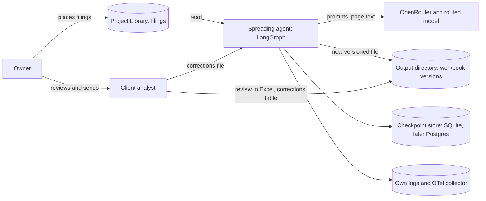
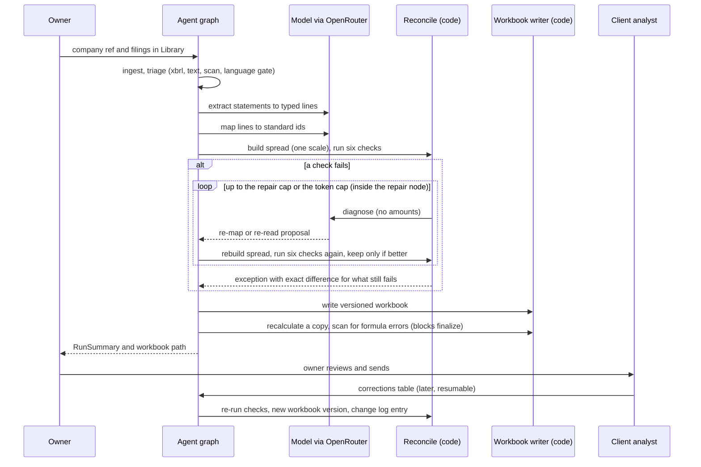

# Architecture: client-0001 financial statement spreading pilot

Version: as built · Spec: the engagement spec · Decision record: the framework decision record

## 1. Summary
The agent reads one company's public filings and writes an Excel workbook with the Income Statement, Balance Sheet and Cash Flow Statement in a standard line-item set, a source trace for every number, six reconciliation results and an open-issues list. Analysts at the client review it in Excel; later corrections re-run the checks and write a new version. It works when every delivered workbook passes all six checks or carries an explained exception, with no plug figure and every number traceable (the engagement intent).

## 2. Context
The owner places filings in the project Library. The agent reads them, calls the model provider, and writes workbooks to the output directory. Nothing is sent to the client by the agent; the owner sends. Analysts approve or correct after the run.

## 3. Components
| Component | Responsibility | Code path | Framework primitive | Model | Status |
| :--- | :--- | :--- | :--- | :--- | :--- |
| Entry point | `run_corrections(run_id, path)` re-runs a finished run after analyst corrections; `run_agent(text)` for the evals (splits the request from the `--- page N ---` filing, wraps the filing as an in-memory text-layer document), `run_filings` and `run_library` for Library files (scans get the vision digitizer); builds the graph with the injected clock, run-id source and model client; returns the `RunSummary` JSON, the tool names called and the tokens used. The model client is OpenRouter unless `SPREAD_REPLAY_TRANSCRIPT` names a recorded transcript | `app/agent.py` | compiled `StateGraph` on a SQLite checkpointer | none | built |
| State and schemas | Pydantic models, graph state, reducers, `RunSummary`; a `RawLine` carries the canonical `period`, the printed `period_label` and the printed `section` | `app/state.py` | `TypedDict` state with reducers | none | built |
| Settings | Reads the env names below into a typed, frozen `Settings`; secrets held as `SecretStr`; errors name variables, never values | `app/config.py` | n/a | none | built |
| Graph wiring | Ten nodes (`ingest`, `triage`, `digitize`, `extract_statements`, `map_lines`, `run_reconciliations`, `repair`, `write_workbook`, `verify_workbook`, `finalize`), the branches that end a run early (`triage`, `digitize`, an unbuildable spread) and the repair branch; converts lines printed in another scale to the run scale; reads cost lines printed as positive numbers (cost of sales, operating expenses, income tax) as negative when the period's printed subtotals fit only that form, and reports each flip as `cost_sign_normalised` (`app/repair/spread.py`, step 24); orders periods oldest first; passes earlier token spend to every model node's caller; overwrites `raw_lines` and `mapping` after a re-read; `finalize` refuses an unverified workbook (`FinalizeBlocked`); builds the `RunSummary`; `RECURSION_LIMIT` 25 as a backstop; SQLite checkpointer keyed by `thread_id` = `run_id`, no `interrupt()` | `app/graph.py` | Graph API, conditional edges, SQLite checkpointer (`langgraph-checkpointers`) | none (the model nodes call the caller) | built |
| Ingest and triage | Load Library files (read-only, sha256, kind xbrl / text pdf / scan / xlsx), read text layers (an HTML filing is cut to its income statement, balance sheet and cash flow statement by a deterministic heading locator, one page each, table rows kept as lines; the language gate and the instruction-like-text scan then see only those pages, and a statement the locator misses is absent and ends as `statement_missing_in_source`), English-only language gate, instruction-like text recorded as an open issue, `out_of_scope` / `unsupported_language` / `unreadable_source` for the not-delivered cases. The statement of changes in equity is located as a page too (step 26). | `app/ingest/` | plain functions, wrapped as nodes in step 10 | none | built |
| Digitizer | Page range in, `DigitizedPage`s out (cells with row, col, text, confidence; bbox is `None` for the vision route); records digitizer name and version; cells below 0.7 confidence (placeholder) become `low_confidence_read` open issues; unreadable pages become `unreadable_page`, and a range with no readable page ends `not_delivered` with `unreadable_source`. Route behind one interface: vision (provisional, from the spike), model from `SPREAD_MODEL`, page image = the scan's embedded image via pypdf; Docling and PaddleOCR are being measured separately | `app/digitize/` | plain node behind an interface (`DigitizerRoute`), wrapped in step 10; text-layer PDFs and XBRL bypass it | OpenRouter vision call through `StructuredCaller` | built |
| Extraction | One validated model call per page with text (a page of more than 40 rows is read in parts split at row breaks, each later part repeating the first 12 rows as context, and a part whose reply is not valid JSON is read again in halves, because a reply over the ceiling is cut; step 20); returns labels and values as printed, and the column heading as printed; code turns each heading into a canonical period key (`app/periods.py`), keeps the printed heading in `period_label`, and records `period_not_canonical` for a date-like heading it cannot read; code keeps a line only if label and value (brackets and sign included) are printed on the same row of the page, after print-layout noise is removed on both sides (`( 2,037 )` is `(2,037)`, `$ 712` is `712`; digits, brackets and signs are never changed); a page the model found no currency on is read as USD, GBP or EUR when it prints exactly one of `$` `£` `€` and no currency code, with the open issue `currency_assumed_from_symbol`; `parse_amount` reads amounts from the printed text. A page that opens with the equity statement heading is read with its own prompt (`extract_equity`) for the retained earnings column only: rows with `statement` `SE`, the heading of the block as `period`; a model line of the wrong kind for its page is dropped and reported (step 26). A line dropped because its label is not on the row is read once more per page (prompt `reread_dropped`, step 28): the model is shown only the dropped (period, label, value) lines, and a reread line counts only if it matches one of them and passes the same row check. A balance sheet row printed as a bare number is named by code from the sums of the rows above it, only where the sum holds in every period column (`app/extract/unlabeled.py`, step 28); the line is flagged `unlabeled_total_inferred` and shown as "(no label printed)" in the trace. An empty value cell of an inline XBRL row (a nil fact) stays in the page text as `[blank]`, and a line whose value sits in a different column from its period is dropped and flagged `value_in_blank_column` (step 30). | `app/extract/` | model node, schema-validated output | `SPREAD_MODEL` (chosen by evals) | built |
| Mapping | Rule table first, by label and by label with printed section (a hit never calls the model), then the model constrained to the statement's standard line ids; labels only, no amounts; `origin` recorded; a total or subtotal line keeps one raw line per period (rule hit, then confidence), the rest are unmapped and flagged `duplicate_total_mapping` (step 22); a printed "Total ..." line, or a line equal to the sum of all the other lines on its detail line, is unmapped and flagged `printed_total_not_added` (step 23), so a total is never added to its parts. Every `SE` row maps to `bs_re_column_movements` by rule, with no model call (step 26). | `app/mapping/` | model node plus rule lookup | `SPREAD_MODEL` (chosen by evals) | built |
| Period keys | Turns a printed column heading into a canonical key (`YYYY-MM-DD` for a balance sheet date, `START..END` for a duration; a bare year takes its page's single "months, quarters, weeks or year ended" phrase; "Quarters Ended" in the plural is read; a heading written out in full must name a year the page prints); pure code, no model; finds the prior balance sheet date by date arithmetic | `app/periods.py` | plain functions | none | built |
| Printed sections | Reads which section of a statement a row sits in (cash flow operating, investing, financing, or the cash summary after net cash from financing; income statement revenue, costs, costs to gross profit when a gross profit line follows the cost block, the block between gross profit or total costs and operating profit, non-operating items between operating profit and profit before tax, rows below the net income row, per share and share count when printed under their own headings; balance sheet assets, liabilities or equity) from the page's own headings; pure code, no model; no section when unsure | `app/sections.py` | plain functions | none | built |
| Reconciliation | The six checks (with canonical period keys each runs on its own kind of period and pairs statements by key, see Period keys), tolerance, exact differences; returns results and open issues, never a figure. `re_rollforward`: when a period has `bs_re_column_movements` (the sum of the equity statement's retained earnings column), the rule is opening + that sum = closing, and dividends paid and net income are not added again; otherwise the earlier rule applies (step 26). | `app/reconcile/` | plain node (pure code) | none | built |
| Diagnosis and repair | Capped loop (`SPREAD_MAX_REPAIR_ATTEMPTS`, token cap): `diagnose` takes the first failed check and the lines it compared and may only propose a re-map (ids from that statement's standard set) or a re-read of a listed page; the reply schema has no amount field and `cause` may not contain a digit; code applies the change, rebuilds `spread` from printed values (`build_spread`) and keeps the change only if fewer checks fail; what still fails becomes an `ExceptionNote` with the exact difference and the attempts made; a line an analyst corrected (`origin` `analyst`) is never offered to the model, re-mapped or re-read | `app/repair/` | model node plus conditional edge | `SPREAD_MODEL` (chosen by evals) | built |
| Workbook writer and verifier | Whitelisted formulas (`templates.py`), nine sheets and versioned file (`writer.py`), recalculated copy with formula-error and cached-value scan (`verify.py`) | `app/workbook/` | plain nodes | none | built |
| Corrections | Reads the corrections columns of a workbook's `Mapping` sheet (`reader.py`: plain text only, lengths capped, a bad row becomes an open issue that names the row and field, never the cell text (a later rejection names the correction id, written to the workbook as a string only); the file must carry the run's id); applies each correction once by `correction_id` (`apply.py`: re-maps the line with `origin` `analyst`, one `change_log` entry with who, what, when, why; a correction that does not fit is rejected with `correction_rejected`; a batch that leaves no spread is refused whole); writes the corrections into the stored state with `update_state(as_node="map_lines")` and continues the same graph from `run_reconciliations` to the next workbook version (`rerun.py`). A re-run cut short is finished by the next call, never applied twice. Where analysts enter corrections is still Flagged concern 9: the table location is the one function `read_corrections` | `app/corrections/` | `update_state` on the stored checkpoint, then the same compiled graph (`langgraph-time-travel`); entry `run_corrections` in `app/agent.py` | none (repair may call `SPREAD_MODEL` if a check still fails) | built |
| Tools and prompts | The one OpenRouter client, `StructuredCaller` (schema validation, one retry, token budget), response schemas with no amount field, versioned prompt files; `ReplayClient` answers from a recorded transcript keyed by a hash of the request and fails on a request it has no reply for (`app/tools/replay.py`) | `app/tools/`, `app/prompts/` | n/a | via `SPREAD_MODEL` | built |
| Mapping accuracy sampler | Seeded draw of 15 IS / 15 BS / 10 CF lines per company from the lines the agent mapped (seed recorded; the owner's labelling file never shows the agent's answer), exact-id scoring, pass line 95% overall and no company below 90% on whole-number arithmetic. Eval-time tool, not part of a run; the development gold set is `evals/gold/mapping_gold.jsonl` (120 owner-confirmed lines from 2 public filings, ids and labels only) | `evals/mapping_accuracy.py` | none (plain CLI) | none | built |
| Mapping data | Provisional standard line set and mapping rules (editable, outside code); line ids are the ones `app/reconcile/rules.py` reads; source signs kept, except income statement costs printed as positive numbers, which `build_spread` reads as negative when the printed subtotals prove it (step 24) | `mapping/` | CSV files, checked on load by `app/mapping/table.py` | none | built |
| Telemetry | Structured JSON logs, OTel spans, allow-list masking | `app/telemetry/` | node wrapper (`traced_node`) | none | built |

## 4. How one run works
One graph run per company, `thread_id` = `run_id`. Review happens after the run, so there is no in-run approval pause. Failed checks go through a capped repair loop and then become exceptions; the workbook is still written. A run ends early without a workbook (`not_delivered`) at `triage` (out of scope, unsupported language), at `digitize` (no readable page, or the digitized text is not English) and when no spread can be built (no mapped statement lines, or mixed currencies); `finalize` records the reason. A node that raises (provider outage, killed process) leaves the run at its last checkpoint, and `resume_run` with the same `thread_id` continues from there; finished nodes do not run again.

## 5. State and data
State schema is in the engagement spec and lives in `app/state.py`. Amounts are `Decimal` (a float is rejected); models are frozen; `RunSummary.plug_figures` can only be 0. `RawLine` carries a `raw_line_id` (not in the spec table) so `mapping` can be keyed by period and raw line id. Append-only channels (`raw_lines`, `exceptions`, `open_issues`, `change_log`, `corrections`, `workbook_versions`) use reducers. `spread` is recomputed from `mapping` and `raw_lines`, never edited. The checkpointer is keyed by `thread_id`; SQLite for public filings, Postgres before any real client document (`langgraph-checkpointers`). Filings and workbooks are client-derived data: they stay in the project Library and the output directory, never in git, never in the knowledge-hub. Pilot data is public; personal data appears incidentally (directors' names or addresses) and is neither copied into outputs nor logged. Logs carry the company pseudonym, check results and token counts, never page text or values with identity. Retention of state and traces: `unknown` until the client sets a rule.

## 6. Side effects and control
No tool in the pilot has an irreversible side effect. The rows below record the two that write anything, why they are reversible, and what is deliberately absent.

| Tool | Effect | Approved by | Idempotency | Rollback |
| :--- | :--- | :--- | :--- | :--- |
| `write_workbook` | Writes a new versioned `.xlsx` in the output directory | none needed (reversible, review after the run by the analyst) | File name is `<run_id>_vN.xlsx`; N is the next free number and a name is claimed with `os.link`, so an existing file is never replaced. If the bytes equal the latest version, that version is returned and no file is written | Previous versions kept; delete the newest file |
| `read_corrections` / `apply_corrections` | Reads the corrections columns of a workbook; applying them appends to `change_log` and the checkpoint, then the graph writes the next workbook version through `write_workbook` | none needed (the analyst's edit is the approval; the system prepares, people approve) | Each correction has an id and is stored in the state's `corrections` channel; the same file applied twice changes nothing and writes no version | The earlier workbook versions are never touched; an earlier checkpoint can be forked (`langgraph-time-travel`) |
| `send_to_client` | Does not exist. The agent cannot send anything | owner sends | n/a | n/a |

## 7. Models and cost
Model-facing nodes: extraction, mapping, diagnosis. Everything else is code. Model id: the owner chose `deepseek/deepseek-v4.1-flash-1017` via OpenRouter (2026-10-21); id and image input confirmed on OpenRouter's model list 2026-10-21 (spike), but capabilities, price and retention `unknown`, confirmed by the first live eval; OpenRouter is the provider (owner decision), model ids are configured (`SPREAD_MODEL`), not hard-coded. All model nodes share one `StructuredCaller`: the schema goes in the prompt and the reply is validated in code, so no provider structured-output feature is relied on (support for this model is `unknown`); a reply that fails validation is retried once with the validation error, every call (retry included) is counted against the token cap, and once the cap is spent no further call is made. The OpenRouter base URL and the OpenAI SDK call shape are not in `docs/reference/`; the first live run (step 12) confirms them. A mapping below confidence 0.7 (a placeholder, not measured) is kept and flagged `low_confidence_mapping`. Extraction costs one call per page with text; choosing statement pages first is a candidate improvement, measured in step 12. Fallback: provider backoff and retry, then pause at the checkpoint; a second route by model id after evals. Every model node's caller starts from the run's token usage so far (`make_caller(tokens_used=...)`), so the cap counts the whole run, not each node; the digitizer route and a re-read share the caller of the node that runs them. Limits: repair attempts per check set (proposed 2), tokens per run (`SPREAD_MAX_TOKENS_PER_RUN`), `recursion_limit` as backstop. Measured on the last live run of the five pilot filings (r15, 2026-10-24, estimates from the runs, not a quote): 31,000 to 96,000 tokens and 85 to 273 seconds per company, 233,000 tokens in total, USD 0.28 upper bound for all five (every token priced at the higher listed rate, USD 1.20 per million), so about USD 0.06 per company. Company A took the most because its repair loop ran twice. These are 10-Q filings of 3 statements each; longer filings or scans will cost more and are not measured. The case `spread-happy-us-3stmt` keeps a ceiling of 60,000 tokens for a small text-layer filing as a guard.

## 8. Failures and recovery
| Failure | What the agent does |
| :--- | :--- |
| Check fails | Capped diagnose and repair, then an exception with the exact difference; never a plug |
| Statement missing in source | Dependent checks `not_applicable`, open issue, delivery with exceptions |
| Scan unreadable | Low-confidence cells to open issues; unreadable statement gives `not_delivered` |
| Model refusal or invalid output | One retry with the validation error, then an open issue; no unvalidated value is written |
| Provider outage or rate limit | Backoff, then pause at the checkpoint and resume with the same `thread_id` |
| Crash mid-run | Resume from the last checkpoint; finished nodes do not re-run |
| Formula error in workbook | `verify_workbook` blocks `finalize` |
| Rejected or contested mapping | Analyst correction re-runs the checks; nothing is overwritten, a new version is written |
| Corrections file is the wrong one, edited badly or applied twice | A file from another run, or without the mapping and correction columns, is refused. A bad row is skipped with an open issue; a reused id with other content is rejected; the same file again writes nothing. A call killed after the corrections were stored but before the new version was written is finished by the next call |

## 9. Observability and audit
Structured logs and OpenTelemetry spans are emitted to our own environment; LangSmith tracing is off (`langsmith-observability`). OTel emission for LangGraph is hand-written around the nodes because the wiki has no source for it (`app/telemetry/spans.py`). Masking is an allow-list (`app/telemetry/masking.py`): fields outside it are dropped, log messages must be fixed event names, exception messages are replaced by the exception type, and `company_ref` must match the pseudonym pattern `company-<id>` or it is masked. Spans carry `run_id`, `company_ref` and `node` only. The exporter is injected, so the collector address is configuration, not code. Audit trail: `Source_Trace` sheet for every number, `Mapping` with origin and rationale, `Change_Log` with who, what, when, why, plus model id and prompt version per run. Evals: `evals/cases.jsonl` (11 cases) run by `python evals/run_evals.py --threshold 0.9`; a hand-checked gold set from public filings measures mapping accuracy and blocks CI on regression. The CI `gate` runs tests and evals.

## 10. Deployment and configuration
Where it runs: `unknown` (the owner's environment for the pilot; the client runs nothing). Packaged as a Python 3.12 application. Rollback: previous workbook versions are kept, and state can be rewound from checkpoints. No secrets in files.

| Variable | Purpose | Required |
| :--- | :--- | :--- |
| `COGNITIA_OPENROUTER_API_KEY` | Model provider key | yes |
| `COGNITIA_ANTHROPIC_API_KEY` | Eval judge, only if a judge check exists | no |
| `EVAL_JUDGE_MODEL` | Eval judge model id | no |
| `SPREAD_CHECKPOINT_DB` | Checkpoint store location | yes (proposed name) |
| `SPREAD_OUTPUT_DIR` | Where workbook versions are written | yes (proposed name) |
| `SPREAD_MAX_REPAIR_ATTEMPTS` | Repair cap, default 2 | no (proposed name) |
| `SPREAD_MAX_TOKENS_PER_RUN` | Spend cap per run | yes (proposed name) |
| `SPREAD_PROMPT_VERSION` | Prompt version recorded per run, default `v1` | no (proposed name) |
| `SPREAD_REPLAY_TRANSCRIPT` | Path of a recorded model transcript; when set, the model nodes replay it instead of calling OpenRouter (CI evals, offline runs). Never set in production | no |
| `SPREAD_MODEL` | OpenRouter model id for the model nodes (owner chose `deepseek/deepseek-v4.1-flash-1017`; id and image input confirmed 2026-10-21, structured output unverified); required by the model nodes, not by the other settings | no, until a model node runs (proposed name) |

Runtime dependency of the verifier: `verify_workbook` needs LibreOffice (`soffice`) on the host that runs the graph. Without it verification fails closed (`libreoffice_unavailable`), so `finalize` is blocked rather than skipped.

## 11. Decisions
See the framework decision record (LangGraph Graph API and OpenRouter, approved 2026-10-20; Pydantic AI was the closest alternative).
- 2026-10-20: model never writes cell formulas; a whitelisted writer places them (`excel-output-with-live-formulas`). Alternative rejected: model-written formulas, which fail silently.
- 2026-10-20: reconciliations, workbook writing and verification are plain code. Alternative rejected: model-judged checks, because the client wants rules, not opinion.
- 2026-10-20: no `interrupt()` in the pilot because review is after the run (`langgraph-hitl-interrupts`); revisit for phase two approvals.
- 2026-10-20: no filing fetch tool in the pilot; the owner places filings in the Library, because access methods and terms for EDGAR and Companies House are `unknown`. Alternative: a fetch tool, deferred.
- 2026-10-21: the checks read sum rules (`app/reconcile/rules.py`) and a provisional line-id set; a printed total with no detail lines is skipped, a missing detail line counts as zero when others are present, and `difference = actual - expected` keeps its sign. Alternative rejected: deriving the rules inside the check code, which would tie the client's template to code.
- 2026-10-20: digitizer route not fixed; chosen by a capped spike (Flagged concern 4 in the engagement spec).
- 2026-10-21 (step 5): the writer builds formulas only from four templates (`sum`, `difference`, `ok_check`, `count_status`) and cell references; filing text is always written as a string cell. Verification recalculates a copy and also compares every formula's recalculated value with the cached value the writer stored, so a wrong cache or a wrong reference fails, not only `#REF!`. A spread number with no raw line behind it, or a formula row that disagrees with a traced spread value, blocks the write. Derived numbers (formula totals, reconciliation figures) are traced through the cells they come from; `Reconciliations` lists those cells under Terms. Verification fails closed on any unreadable file and on a workbook with no formulas.

## 12. Limits and open questions
The agent must never: insert a plug or balancing figure; send anything to the client; invent a statement missing in the source; copy filing text or personal data into logs or outputs; write a number that did not come from a source cell or a formula; process real client documents before the data-handling answer exists.
Known limits: English-language filings only; the pilot ran on five US 10-Q filings in HTML with a text layer and inline XBRL, so scanned filings (the digitizer route is provisional, the spike was not finished), UK filings and spreadsheets are not proven; mapping accuracy was scored at 96.3% (183 of 190 lines) in step 17 and not rescored after steps 25 to 30; the model id `deepseek/deepseek-v4.1-flash-1017` works on the pilot but its retention terms and structured-output support are `unknown`; an empty cell is only recognised as empty in inline XBRL filings (step 30); restricted cash that a filing prints only as a closing figure stays an explained exception (step 29); human review time was not measured; the client's template arrives after the NDA.
Open questions (owner in brackets), all numbered in the engagement spec "Flagged concerns": scope confirmation (owner); volume and effort against the fixed price (owner); pilot acceptance and mapping sample (owner, client); spike spend cap (owner); where analysts enter corrections (owner, client); OpenRouter terms and the third-party list (client policy owner); which filings include all three statements (owner); runtime Python and deployment location (owner); trace retention (client).

- 2026-10-21: digitizer route is the vision model, provisional; the owner started step 8 before the spike was final. Re-measure on 2 real scanned filings before the pilot relies on it; the interface keeps the route swappable (plan step 1).
- 2026-10-21 (step 10): the repair loop runs inside one `repair` node (its cap is `SPREAD_MAX_REPAIR_ATTEMPTS` and the token cap), not as a graph cycle, so the caps live in one place and `recursion_limit` (25) is only a backstop. Alternative rejected: a `diagnose` to `repair` to `run_reconciliations` cycle in the graph, which would split one capped loop across three nodes and two counters. `ExceptionNote.difference` is the size of the difference (the spec's example), and the signed figures (actual minus expected, as the engine reports them) stay in its explanation.
- 2026-10-21 (step 15): periods are canonical keys computed in code (`app/periods.py`), not the model's label: `YYYY-MM-DD` for a balance sheet date, `START..END` for a duration, so the checks pair statements by date; the printed heading is kept in `RawLine.period_label`. When any period does not parse the older rule (previous entry is the prior period, ordering by the year in the label) still applies, so the eval cases with `FY2023` labels are unchanged. A bare year or plain date takes its length from the page's single "n months, quarters, weeks or year ended" phrase (a balance sheet column becomes a date); with two phrases nothing is rescued and `period_not_canonical` is recorded. Month, week and year headings are read in US order only ("June 30, 2026"); day-first headings (Companies House) are not, so one such heading sends the run to the older rule.
- 2026-10-21 (step 10): lines printed in another scale are converted to the run scale (the scale printed on most mapped lines) by the exact factor in `build_spread`, and an open issue `scale_normalised` says so; mixed currencies are still refused and end the run `not_delivered` with `unreadable_source`. Periods are ordered by the year in the label; without years the printed order (newest first) is reversed and `period_order_assumed` is recorded.
- 2026-10-21 (step 10): the offline evals replay `evals/transcripts/spread.jsonl`, recorded by `scripts/record_eval_transcript.py` from a rule-based stand-in for the model (`tests/scripted_model.py`), not from a live model. A passing replay proves the graph, the checks and the writer work end to end; it says nothing about the chosen model's accuracy, which step 12 and the live run measure. A prompt or schema change needs the transcript re-recorded (a request with no recorded reply fails with `ReplayMiss`, never a guess). The scheduled weekly CI run uses the same replay, so it detects code drift, not model drift.
- 2026-10-21 (step 10): the CI `evals` job installs LibreOffice (`verify_workbook` fails closed without it) and sets the replay and settings variables, with a placeholder key that is not a secret.
- 2026-10-21 (step 11): a correction re-run is the same compiled graph resumed after `update_state(as_node="map_lines")`, not a second graph, so checks, repair, the writer and verification are the code that delivered the first version. Alternative rejected: a separate `apply_corrections` node ahead of `run_reconciliations` in the graph, which would run on every first run and need a flag to skip. Because repair runs in that flow, a line an analyst corrected is final: repair never offers, re-maps or re-reads it; a check that still fails ends as an exception with the analyst's mapping kept. Earlier exceptions are cleared before the re-run (they described the old mapping); open issues are append-only, so issues from earlier passes stay in the list.
- 2026-10-22 (step 18): the extraction prompt asks for the span line together with its date as one `period` text, so a three-month and a six-month column printed under the same year get different headings; the offline transcript was re-recorded for the new prompt. Live on the three pilot filings that collided, every column now has its own key (the checks pair; mapping errors remain). A page whose model reply is empty still fails as `extraction_invalid_output` (seen once on A; the next run was clean).
- 2026-10-22 (step 19): a label's meaning can depend on its section (cash flow "Other", a balance sheet "Deferred income taxes", an income statement "Products"), and the mapper sees labels only. `app/sections.py` reads the printed section from the page's own headings in code; the section is stored on each `RawLine`, selects a rule in `mapping/section_rules.csv`, and is shown to the model for lines no rule covers. Opening and closing cash have their own standard lines (`cf_cash_beginning`, `cf_cash_end`), owner decision 2026-10-22. A line printed above every heading, or the same label and value under two headings, has no section and is mapped by label as before.
- 2026-10-22 (step 20): a page is read in parts when it has more than 40 rows, because the model's reply is cut at `MAX_REPLY_TOKENS` and a cut reply is invalid JSON; the cut is detected as invalid output and the part is read again in halves, not by trusting a finish reason, which the model client does not expose. Each later part repeats the first 12 rows as context and is told to list only the rows after a marker; verification of every line still runs against the whole page text.
- 2026-10-22 (step 21): whether a generic cost line ("Other", an "Other, net" line or a total of the cost block) is cost of sales or operating expenses depends on whether a gross profit line follows the block, so code reads that from the page (`costs_to_gross_profit` against `costs`) and section rules map the generic labels by it (owner decisions: lines of the block above gross profit are cost of sales, lines of a block that ends at operating income are operating expenses). Lines that name cost of sales, products or services costs keep their own rules.
- 2026-10-22 (step 22): a printed subtotal such as "Total current liabilities" has its own subtotal standard line, and `map_lines` lets a total or subtotal line hold one printed figure per period. Alternative rejected: making `build_spread` skip totals, because it has no table and is called from the repair loop, corrections and the graph.
- 2026-10-22 (step 23): the standard set has no line for a printed total of detail lines ("Total revenues", "Total operating costs and expenses"), so such a total and its parts landed on the same line and were added, doubling the figure. The parts are the figures the spread keeps; the total is left out, and reported, when it shares a line with other lines in a period. A total alone on its line is kept. Checked offline on the saved live run of the five pilot companies before any new live run.
- 2026-10-22 (step 24): some companies print costs as positive numbers (revenue 100, cost of sales 60, gross profit 40), while the sum rules add every component as signed. `build_spread` tests, per period, each cost line against the printed subtotal it feeds (gross profit from revenue and cost of sales, operating profit from gross profit and operating expenses, net income from profit before tax and income tax) and flips the cost to negative only when the subtotal fits the positive form and not the negative one; a cost line with no subtotal to test follows the period when every tested line says positive; no evidence means no change. The flip is a departure from "source signs kept" and is reported (`cost_sign_normalised`, with the period and line), the printed text stays in `Source_Trace`. Alternatives rejected: flipping every positive cost (a credit would be wrong and nothing would show it), deciding by label or size (a guess), and changing the sum rules to accept both (a wrong period would pass). Interest expense is not flipped: its sign is mixed in the filings seen, and no printed subtotal isolates it.
- 2026-10-22 (step 25): earnings per share, weighted-average shares and dividends per share are mapped to five `memo` lines (`is_eps_basic`, `is_eps_diluted`, `is_shares_basic`, `is_shares_diluted`, `is_dividends_per_share`) that no sum rule reads, instead of the "other income statement items" line the checks add into net income. A bare "Basic" or "Diluted" is placed by the printed heading above it (`per_share` or `share_count` section rules). The earlier owner labels that put these lines on `is_other_items` were the best fit available then and are superseded by the memo lines.
- 2026-10-22 (step 26): equity statements were not read, so `re_rollforward` could not see movements that only that statement shows (a repurchase charged to retained earnings: 682,835 on one pilot company, exactly; dividends declared against paid: 13 on two). The owner approved reading the retained earnings column (spec, "Retained earnings rollforward source"). Alternative kept out: inferring the movement as the gap, which is a plug and is refused. A wrong column read still shows as a failed check with the exact difference. Also in step 26: on `bs_total_equity` the last printed total wins a tie, because equity prints "Total shareholders' equity", the minority interests, then the grand total.
- 2026-10-22 (step 27): the printed sections now also separate the rows below net income (`is_below_net_income`, a memo line: comprehensive income, noncontrolling interests, preferred dividends), the rows between operating profit and profit before tax (`is_non_operating_items`, in the profit before tax and net income sums), other items between the costs and operating profit (`is_operating_income_items`, in the operating profit sum) and cash flow rows after the cash summary (`cf_supplemental_items`, memo). Each is decided from the page's printed rows in code, so a figure is never moved by a guess; `build_spread` reads interest expense and the non-operating items by the profit before tax identity (a line is flipped only when every reading that fits agrees). Alternative not taken: widen the sum rules to every "other" line, which would hide a mapping error behind a matching total.
- 2026-10-23 (step 28): a balance sheet that prints its subtotals as bare numbers (company D) gave the model nothing to copy, so the totals were never read and `bs_balances` was not applicable. Code names such a row only when exact sums prove it in every period column (`app/extract/unlabeled.py`), flags it `unlabeled_total_inferred` and shows "(no label printed)" in the trace. Alternative rejected: asking the model to label the row, which would put a guess where a proof is possible. The same step reads dropped lines once more: when the model writes a label the page does not print on that row, one extra call (prompt `reread_dropped`) is asked only for those lines and they are kept only if they match a dropped (period, value) and pass the same row check.
- 2026-10-23 (step 29): the reconciliation tolerance is two units of the reported scale (`Settings.rounding_tolerance_units`), after company C's balance sheet differed by 2 from rounding. Restricted cash is not added to the cash check: company A prints only the closing figure, and deriving the opening one would be a balancing figure, which the plug rule forbids, so A's 15 stays an explained exception.
- 2026-10-24 (step 30): an empty value cell of an inline XBRL row (a nil fact) stays in the page text as `[blank]`, because the lost cell made the model read one number in the wrong period (company A, 35 in 2026 instead of 2025). Code also drops a line whose value sits in a different column from its period (`value_in_blank_column`), so a model slip cannot move a number between periods. Limit: only nil inline XBRL cells are marked.
